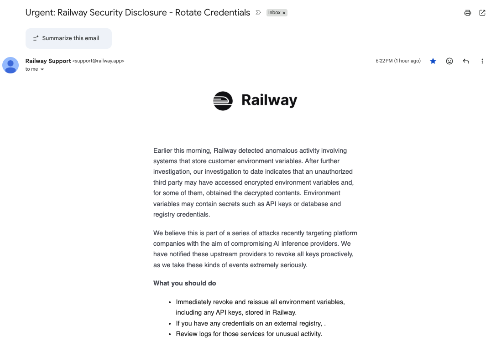

On October 21, 2026, I received a security notice from Railway, the platform where I host TracePull. It warned that customer environment variables—including credentials used to access other services—may have been exposed.

I reviewed my application’s configuration, revoked its OpenAI API key, and accounted for a GitHub token that had already expired.

Those actions addressed the immediate concern about continued use of those credentials. They also left me with a question:

**If we act only after a possible exposure, what have we protected—and what remains unresolved?**

That question matters as AI becomes more deeply connected to the systems we build.

AI helps us write software, retrieve organizational knowledge, analyze documents, and automate workflows. These capabilities depend on access: to repositories, model providers, databases, internal documents, and tools that perform actions.

Every connection introduces a responsibility. We need to understand what access we have granted, how it could be misused, and how to withdraw it.

Attackers are adopting AI too. The UK’s National Cyber Security Centre assesses that AI will make parts of cyber intrusion more efficient and effective. Anthropic has also reported cases of threat actors using its models to support cyber operations. AI is changing the speed and scale at which some malicious work can be performed. [NCSC assessment](https://www.ncsc.gov.uk/report/impact-ai-cyber-threat-now-2027), [Anthropic threat report](https://www.anthropic.com/threat-intelligence-report-september-2026)

That broader trend needs to be distinguished from this particular incident. **Railway’s disclosure did not establish that attackers used AI to carry out the intrusion.** Railway described possible access to environment variables and said it believed the incident was connected to attacks targeting AI inference providers. The investigation was ongoing. [Railway’s security disclosure](https://blog.railway.com/p/security-disclosure-wednesday-october-21st)

My response did not depend on knowing the attackers’ methods. A credential that may have been exposed required attention.

Reviewing TracePull’s configuration identified two relevant secrets: `OPENAI_API_KEY` and `GITHUB_TOKEN`. Other entries described model settings, timeouts, domains, and filesystem paths.

I revoked the OpenAI key at its source. My GitHub fine-grained token had already expired under the seven-day lifetime I had configured.

This was a containment decision. Thankfully, when I went through the logs in my openAI account both in usage and logs, there were no suspicious calls. TracePull is a invite only system and thus it escaped the threat and saved my credit card bill from exploding.

Revocation helps because exposure and misuse do not necessarily happen at the same moment. A copied credential may remain useful until it expires or is invalidated. Revoking it closes that particular route for future authentication once the provider enforces the change.

Deleting the value from Railway would not have accomplished that. Someone holding a copy could still use it against the issuing provider.

But revocation cannot reverse earlier activity. It cannot recover copied information, undo charges, or guarantee that an attacker has not established another form of access. Existing sessions or credentials created during an intrusion may require separate action.

**A revoked key closes one route. It does not answer every question about what happened while that route was open.**

This is why reviewing usage, access logs, and unexpected account changes remains separate work. My immediate response handled the credentials; it did not constitute a completed investigation.

The expired GitHub token also illustrates why credential management can be proactive. I had set its lifetime before receiving the notice. That decision limited how long the token could remain usable without requiring me to discover an incident first.

Seven days is still an exposure window. Expiration does not prove that a credential was never misused. Its value is placing a boundary on future use.

For machine credentials, a stronger approach combines several controls: narrowly scoped permissions, separate identities for different workloads, short lifetimes where supported, and reliable revocation. Teams also need to know who owns each credential and which services depend on it. Automated replacement and audit records make that lifecycle easier to operate. [OWASP secrets management guidance](https://cheatsheetseries.owasp.org/cheatsheets/Secrets_Management_Cheat_Sheet.html)

For AI platforms, these principles lead to practical design questions.

If a model-provider credential is exposed, can we identify every application that uses it? Can we disable one workload without interrupting unrelated services? Can we detect unexpected consumption? Can replacement credentials reach applications when the normal deployment process is unavailable?

An AI gateway can provide a place to enforce access and observe usage. Its own credentials and administrative permissions also need protection. Centralizing access makes the design of that boundary especially consequential.

For retrieval systems, the questions extend to information access. Alongside datasets that evaluate answer quality, I would include tests for whether users can retrieve documents beyond their permissions and whether access restrictions survive the retrieval workflow.

These are design considerations I would bring into a broader platform review. They go beyond the actions I performed for TracePull.

AI can support defensive work as well: helping review code, summarize logs, and prioritize suspicious activity. Those outputs still need validation, and automated actions need bounded authority. A useful security assistant should operate within an explicit permission model.

No system comes with a guarantee of immunity. Security engineering gives us ways to reduce the likelihood of compromise, limit its consequences, detect activity, and recover.

This incident made that responsibility concrete for me. A short credential lifetime helped. Revocation was possible without waiting to restore the application. Neither action justified declaring the investigation complete.

As we connect AI to more of our software and organizational knowledge, I want one question to become part of routine engineering reviews:

**If a credential were exposed today, how quickly could we identify what it can reach, stop its use, investigate its activity, and restore the affected service?**

We can test those capabilities before the next security notice arrives.
