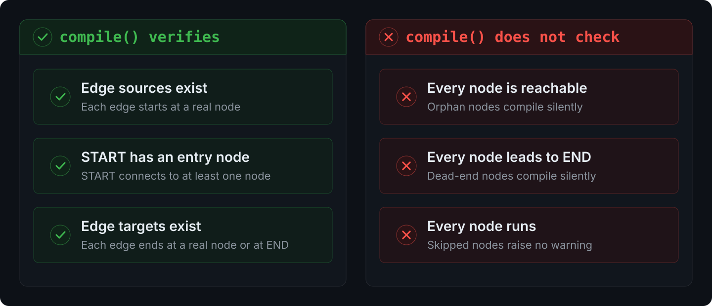

I am deep into building agents using LangGraph and encountered this use case.

I am building a purchase-to-invoice workflow in LangGraph. It had five nodes in a straight line: load the purchase request, validate the approval, create the purchase order, create the invoice, and finish. To force an error, I commented out one edge. I expected a compile error. If not that, I expected a runtime error.

I got neither. The graph compiled clean. The graph ran clean. The graph returned **success**. But it skipped a step. It created the purchase order and never created the invoice.

I was surprised, because a workflow that crashes tells you something is wrong. A workflow that reports success while it skips a step tells you nothing. This article explains the cause, the mechanism underneath, and the two controls that catch it.

## The reproduction

Each node in my graph prints its own name when it runs. A healthy run prints four lines and ends with `status = "completed"`.

Then I removed one edge:

```python title="graph.py"
graph.add_edge("create_purchase_order_from_request", "create_an_invoice")
```

I ran the graph again. The output changed:

```text title="output"
Executing: load_purchase_request
Executing: validate_purchase_request_is_approved
Executing: create_purchase_order_from_request
```

The run stopped after the purchase order. The invoice line never printed. The final `status` was `"purchase_order_created"`, not `"completed"`. No exception was raised. The caller received a normal return value. Nothing in the return told me that the invoice was never created, and that a financial record was missing.

## What compile() actually checks

`StateGraph.compile()` runs a validation step. That step confirms three things. First, each edge starts at a real node. Second, `START` connects to an entry node. Third, each edge ends at a real node or at `END`.

The validation step stops there. It does not check that every node is reachable. It does not check that every node leads to `END`. It does not check that every node runs. That is the gap I understood.



This surprises many engineers. Some popular tutorials state that `compile()` verifies reachability. It does not. An [open LangGraph issue](https://github.com/langchain-ai/langgraph/issues/6735) reports the same behavior and asks the maintainers to add a detached-node check. The check does not exist today. So the gap is real, and it is known.

## One gap, two failure modes

The single missing edge can produce two different bugs. The direction of the edge decides which one you get.

**Remove the edge out of a node.** The node still runs. It does its work and writes its state, and the graph stops, because nothing downstream is triggered. LangGraph calls this a dead-end node. This is the case I described above: the purchase order was created, and the invoice step was never reached.

**Remove the edge into a node.** The node never runs, for any input. Nothing ever triggers it. LangGraph calls this an orphan node. The node stays in the compiled graph and does nothing. My invoice logic would sit there, correct and complete, but never executed once.


Same cause. Two different bugs. Zero errors either time. From LangGraph's side, this may be what it offers today. But when you are the developer and maintainer of the agent, it is a bug for you.

**It is a bug for you because** your business flows do not run or complete as expected. It does not fail loud, so you may not catch it. A code review can easily miss it, because code review tools are limited: they do not check whether nodes reach one another through edges, or whether every node is connected starting from `START`. And `END` is always optional in the LangGraph library.

## Why the engine reports success

To understand the silence, you must look at how LangGraph runs a graph. The engine is called Pregel. It uses the Bulk Synchronous Parallel model. It does not follow edges one by one like a normal function-call chain.

Instead, the engine runs in discrete rounds called supersteps. Nodes communicate through channels, which are shared state slots. Each superstep has a plan phase. In that phase, the engine looks at which channels changed in the previous superstep. It then selects every node whose trigger condition is now satisfied. It runs that set of nodes. It collects their writes. It repeats.

The engine stops when one condition is true: the next superstep has no nodes to run. An empty plan means the graph is done.


Now the problem is clear. A graph that reached `END` and a graph that ran out of edges both produce an empty plan. To the engine, the two states look identical. Both mean "no node is triggered next." So the engine ends normally and reports success in both cases. It has no separate concept of "finished correctly" versus "stuck with nowhere to go."

## Why END is not special

Many engineers assume `END` is a required terminal step, like a `return` statement. It is not. `END` is a plain string constant with the value `"__end__"`. An edge into `END` is just a write to a channel named for that target. The engine does not need this write to terminate. It terminates whenever the plan is empty, with or without `END`.

So `END` documents intent for the reader. It marks where you meant the graph to stop. It does not act as a guard. Removing the path to it does not raise an error, because the absence of a next node ends the run on its own.

## Why I think the framework makes this choice

Here is my reasoning. This gap is not a simple oversight. Static reachability is hard to prove in LangGraph, because routing is often dynamic. Conditional edges choose the next node from the current state. The `Command` object lets a node return both an update and a target at run time. With dynamic routing, the compiler cannot know in advance which nodes are reachable. A node that looks orphaned in the static edge list may be a valid target of a conditional route.

So the framework stays permissive by design. It validates references, and it leaves reachability to the developer. That is a fair trade for flexibility. But it means the safety net you expected is not there, and you must add your own.

## How to catch it

Two controls close the gap.

**Control one: read the compiled graph, not the edge list.** Call `get_graph()` on the compiled graph. This builds a drawable graph from the compiled node-and-trigger wiring, which is the same wiring the engine uses to schedule. A dead-end or orphan node shows as disconnected. You can render it with `draw_mermaid()` and look, but few teams check a diagram in continuous integration. So automate the check instead:

```python title="test_graph.py"
def find_detached_nodes(compiled):
    g = compiled.get_graph()
    sources = {e.source for e in g.edges}
    targets = {e.target for e in g.edges}
    dead_ends = [n for n in g.nodes if n not in sources and n != "__end__"]
    orphans  = [n for n in g.nodes if n not in targets and n != "__start__"]
    return dead_ends, orphans
```

Run this in a test. Fail the build if either list is not empty. Adapt it if you use conditional edges, because a conditional target is reachable even when it has no static incoming edge.

**Control two: assert on the final state.** Do not test only for the absence of a crash. A "no exception" test would have passed on my broken graph. Assert on the result instead. Test that `status` equals the value you expect. Test that the invoice object exists in the final state. A pass or a fail must depend on the output, not on whether the run threw.

## Takeaways

- `compile()` checks edge references and one entry point. It does not check reachability.
- A missing edge **out** of a node creates a dead-end node. The node runs, then the graph stops.
- A missing edge **into** a node creates an orphan node. The node never runs.
- The engine stops when no node is triggered next. A correct end and a stuck end look the same to it.
- `END` is the string `"__end__"`, not a required step. An empty plan ends the graph on its own.
- Reachability is left to you, because dynamic routing makes it hard to prove at compile time.
- Add a detached-node test, and assert on the final state. Never trust a "no crash" result.
